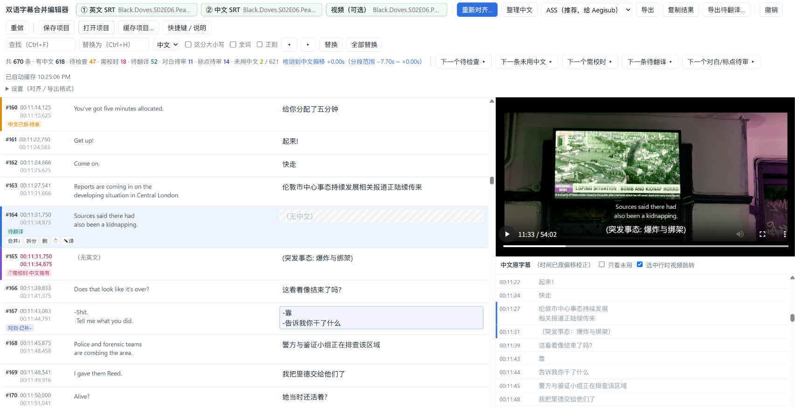

# 双语字幕合并编辑器

A browser-based tool to merge English and Chinese SRT subtitles into bilingual ASS/SRT.

把**英文 SRT** 和**中文 SRT** 合并成双语字幕的网页小工具：自动检测时间偏移、按时间重叠把中文分配到英文时间轴上，可视化逐条检查修改，最后导出 **ASS**（推荐，适合 Aegisub）或 **SRT**。

👉 **在线使用：** https://aud-sin.github.io/srt-bilingual-merge/

截图：

## 特点

- **打开就能用**：单个 HTML 文件，不用安装也不用注册，浏览器打开即可，下载到本地离线也能用。
- **隐私安全**：字幕和视频只在你自己的浏览器里处理，**不会上传到任何服务器**。
- **以英文时间轴为准**：适合给视频里内封的英文字幕配上外挂的中文译文。

## 主要功能

**自动对齐**
- 自动检测中文字幕的整体偏移，并按分段做局部微调，应对片中偏移变化；也可以手动指定偏移。
- 按时间重叠把中文分配到每条英文上；一句中文跨两条英文时，按标点/空格自动拆开，并标出来待检查。
- 括号里的中文注释（如“（东罗斯威尔，1984年）”）可以单独成条。

**中文整理**
- 标点改半角，省略号可以跟随英文处理。
- 智能判断中文原有换行处要不要加空格，拿不准的会标出来。
- 英文是“- A - B”双人对白、中文却没有“-”时，自动补上；跨条拆开的中文对白，会去掉多余的“-”。
- 英文有 `...` `!` `?` 或引号而中文没有时，按断句位置自动补上。

**编辑与检查**
- 中英对照逐条编辑，配有快捷键：把文字推到上/下一条、合并、拆分、撤销/重做等。
- 用标记提示需要人工看的条目：待检查、⏱需校时（时间为估算）、待翻译、对白/标点待审，每一类都可以一键跳到下一个。
- 右侧显示中文原字幕，标出还没用上的句子。
- 可载入视频，试看当前条目。
- 查找替换，支持全词、正则。
- **专有词汇库**：收集繁中译名，统一替换成简体译名；可导入 IMDb 演员表辅助配对，也能给连写的人名加分隔号。

**导出**
- **ASS**：可自定义模板（样式、英文标签）；“需校时 / 待翻译”写在说话人栏，在 Aegisub 里一眼可见，也能一次选中。
- **SRT**：可选 `\N` 换行，需校时/待翻译的条目带 `{…}` 标记。
- **导出待翻译**：把缺中文的条目连同上下文整理成一段文本，可以直接交给 AI 翻译后按编号填回。

**进度保存**
- 每一集的进度自动缓存在浏览器里，可以同时保留多集；也可以“保存项目”存成文件，换电脑时接着做。

## 使用方法

1. 载入**英文 SRT**（最终时间轴以它为准）。
2. 载入**中文 SRT**（支持 UTF-8 / GBK）→ 点“自动对齐”。
3. 用 `Alt + N` 逐个检查标记的条目，用 `Alt + ↓` / `Alt + ↑` 把文字推到下一条/上一条。
4. 选择 ASS 或 SRT，导出。

完整的快捷键和说明，见工具内的“快捷键 / 说明”。

## 注意

- 进度、词汇库、ASS 模板都保存在**当前浏览器**里。换浏览器、清除浏览器数据都会丢失，重要进度请用“保存项目”存成文件。
- 视频试看依赖浏览器解码：mp4（H.264/AAC）基本都能播放；mkv 在 Chrome/Edge 里常可播放，但 HEVC 视频或 AC3/DTS 音轨可能无画面或无声。

## 本地使用

下载 `index.html`，双击用浏览器打开即可，无需联网。

## 致谢

本工具在 Anthropic 的 AI 助手 **Claude（Opus 5.5）** 的辅助下编写。

## 许可证

[MIT License](LICENSE)
